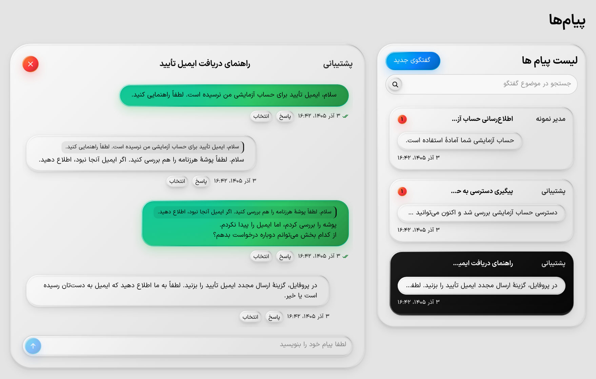
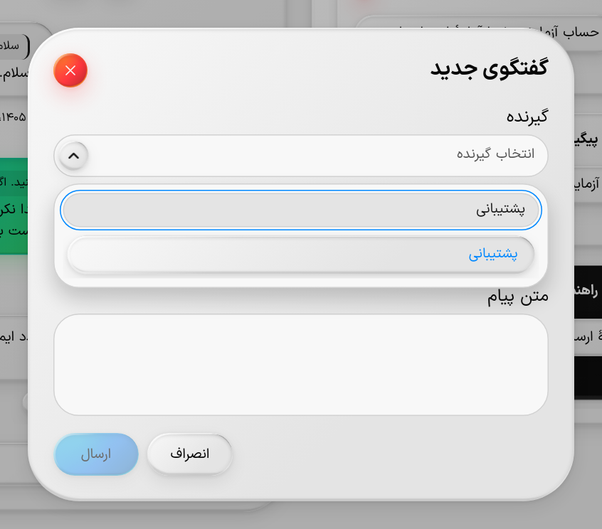
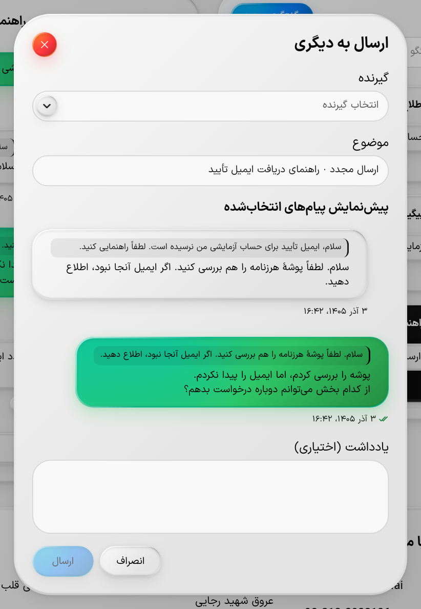
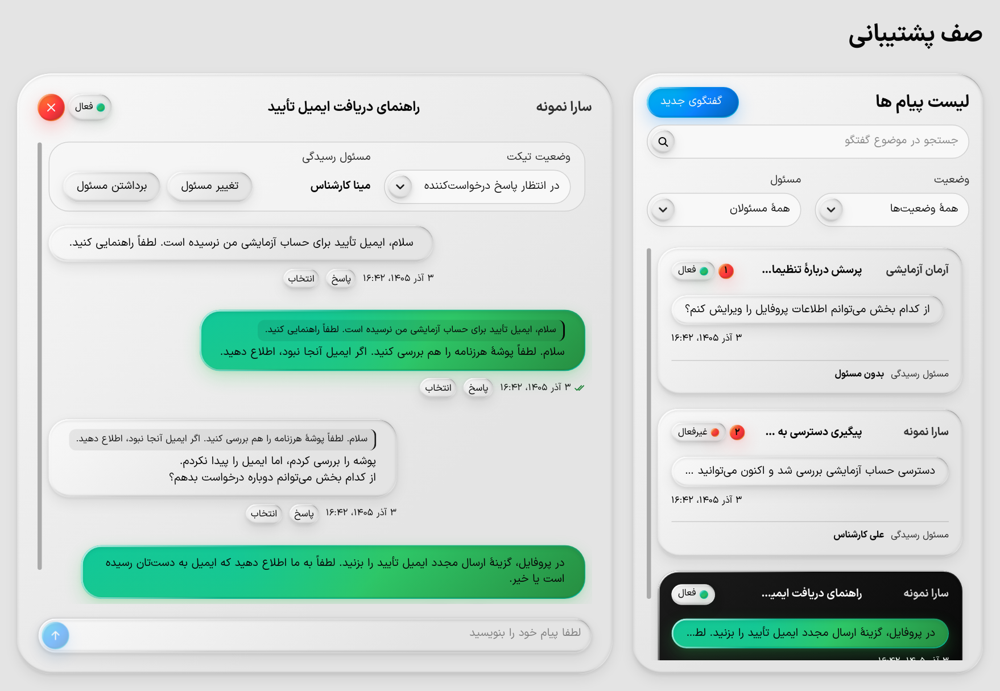
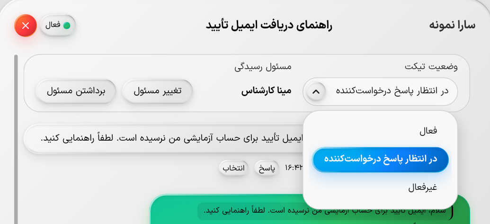
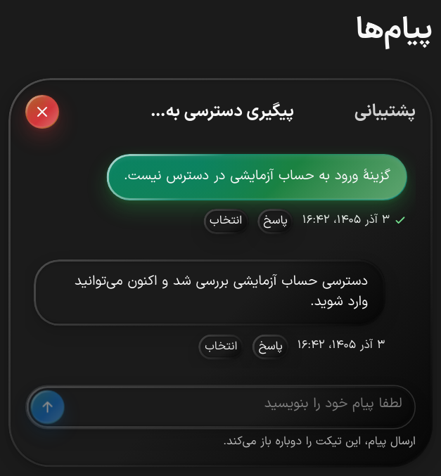

# NCIBB messaging and support tickets

[نسخهٔ فارسی](messaging-ticketing.fa.md)

## 1. Using messaging and tickets

NCIBB uses one conversation interface for ordinary messages and support requests. A conversation sent to the shared **پشتیبانی** (Support) destination becomes a ticket. Permitted direct conversations, mentorship conversations, and messages to the Management queue use ordinary messaging.

Open **Profile → پیام‌ها** to view conversations. Staff with the support capability also have **صف پشتیبانی**, a dedicated queue for the same support tickets. The screenshots in this guide show the Persian interface with synthetic accounts and messages.

### Read and reply

- **لیست پیام ها** shows the subject, counterpart, latest message, and its timestamp. A red badge shows the number of unread messages. Use the search field to find a conversation by subject.
- Select a conversation to open its history. Your messages appear in green on the right. Incoming messages appear in neutral glass on the left. The close button returns to the list on narrow screens.
- Type in the composer to send a regular reply. Select **پاسخ** beneath a message to quote it. Remove the quote using the close button on its preview. When longer text overflows the composer, an expand control appears.
- A clock means the message is sending, one green check means the server accepted it, and two checks mean at least one other authorized reader opened the conversation. A red warning icon marks a failed send, and the draft is available to retry.
- The visible inbox and latest messages refresh about every four seconds. Returning to the tab or reconnecting also triggers a refresh.



*Figure 1. The requester inbox and an open support conversation.*

### Start a conversation or open a ticket

1. Select **گفتگوی جدید**. In an empty inbox it appears beside the page heading. With existing history, it appears in the list header.
2. Open **گیرنده** (Recipient) and search within the dropdown. The available destinations depend on your account and role.
3. Choose **پشتیبانی** for a support ticket, or choose another available destination for an ordinary conversation.
4. Enter a subject and message, then select **ارسال**. Your new conversation opens in the inbox.



*Figure 2. Searching for the shared Support destination.*

### Forward selected messages

1. Choose **انتخاب** beneath each message to forward. Select up to ten messages across the pages of the same conversation. Select a message again to clear its selection.
2. Choose **ارسال به دیگری** in the conversation header. The dialog previews the messages in chronological order with their original bubble colors and full message text.
3. Choose an allowed recipient, review the subject, and add a note if needed. Select **ارسال** to create a new conversation with copies of the selected message text.

The source conversation and its history remain available. Quotes shown in the preview provide source context. The forwarded copies carry the selected message text.



*Figure 3. Reviewing selected messages before forwarding.*

### Work the support queue

Support staff can filter **صف پشتیبانی** by subject, status, and ownership. Open a ticket to claim it with **به عهده می‌گیرم**, assign it to another eligible agent, release the assignment, or change **وضعیت تیکت**. Ownership identifies the agent responsible for the ticket. The support team shares access to the queue.

Support staff see the ticket state as a glass badge. Requesters follow the conversation in their inbox and can reply to a resolved ticket to reopen it.



*Figure 4. Support queue, ticket ownership, and agent controls.*

| Workflow state | Staff badge | Behavior |
| --- | --- | --- |
| Open (فعال) | Green, فعال | New tickets start here without an assignee. Staff can take ownership and respond. |
| Waiting for requester (در انتظار پاسخ درخواست‌کننده) | Green, فعال | Staff set this while waiting for information. The requester's next successful reply returns the ticket to Open. |
| Resolved (غیرفعال) | Red, غیرفعال | Staff set this after resolution. The thread stays visible and replyable. A requester reply reopens the same ticket. |

Staff can set the state using the dropdown. A reply from a support agent in the staff role leaves the state as set. Status, ownership, and unread counts can change independently.



*Figure 5. Changing the state from the support controls.*



*Figure 6. A resolved ticket in the requester's narrow dark-mode view. The note below the composer explains that a reply will reopen it.*

## 2. Engineering guide

### Stack and entry points

| Layer | Libraries and responsibilities |
| --- | --- |
| Frontend | React 18 and TypeScript for UI and state, React Router for profile tabs, and Vite for development and production builds. HeroUI supplies button and modal behavior, with NCIBB glass CSS and Framer Motion for presentation. Versions are declared in [package.json](../frontend/package.json). |
| HTTP client | Axios in [api.ts](../frontend/src/dataset_services/api.ts) attaches JWT bearer tokens and handles token refresh. [accountApi.ts](../frontend/src/dataset_services/accountApi.ts) exposes typed messaging calls. The client uses relative `/api` URLs. [vite.config.ts](../frontend/vite.config.ts) configures the development proxy. |
| Backend | Django 5.2, Django REST Framework 3.16, and Simple JWT 5.5 manage routes, validation, and authentication. PostgreSQL is used in production and SQLite is the local default. See [requirements.txt](../backend/requirements.txt) and [settings.py](../backend/ncibb/settings.py). |

The UI enters through `/profile?tab=messages` or `/profile?tab=support`. Profile navigation exposes the support tab through the `messaging.support_queue` capability. Django mounts the application under `/api/messaging/`. [ProfileManager.tsx](../frontend/src/components/profile/ProfileManager.tsx) · [navItems.ts](../frontend/src/components/profile/sidebar/navItems.ts) · [Django project URLs](../backend/ncibb/urls.py)

### Source map

| Update | Starting points |
| --- | --- |
| Inbox, filters, selected conversation, and compose handoff | [MessagesTab.tsx](../frontend/src/components/profile/messages/MessagesTab.tsx) · [ConversationList.tsx](../frontend/src/components/profile/messages/ConversationList.tsx) |
| History, replies, read markers, and forwarding selection | [ConversationDetail.tsx](../frontend/src/components/profile/messages/ConversationDetail.tsx) · [MessageHistory.tsx](../frontend/src/components/profile/messages/MessageHistory.tsx) · [useConversationDrafts.ts](../frontend/src/components/profile/messages/useConversationDrafts.ts) |
| Composer sizing, recipient search, and dialogs | [ReplyComposer.tsx](../frontend/src/components/profile/messages/ReplyComposer.tsx) · [useReplyInputSize.ts](../frontend/src/components/profile/messages/useReplyInputSize.ts) · [ComposeDialog.tsx](../frontend/src/components/profile/messages/ComposeDialog.tsx) · [useMessagingSearch.ts](../frontend/src/components/profile/messages/useMessagingSearch.ts) · [ProfileModal.tsx](../frontend/src/components/profile/shared/ProfileModal.tsx) |
| Ticket assignments and role-specific presentation | [TicketControls.tsx](../frontend/src/components/profile/messages/TicketControls.tsx) · [TicketBadge.tsx](../frontend/src/components/profile/messages/TicketBadge.tsx) · [ticketStatus.ts](../frontend/src/components/profile/messages/ticketStatus.ts) |
| Background refresh and scroll position | [useMessagingRefresh.ts](../frontend/src/components/profile/messages/useMessagingRefresh.ts) · [useAccountQuery.ts](../frontend/src/components/profile/shared/useAccountQuery.ts) · [useConversationTimeline.ts](../frontend/src/components/profile/messages/useConversationTimeline.ts) |
| Layout, color, and shared input styling | [messages.css](../frontend/src/components/profile/messages/messages.css) · [theme.css](../frontend/src/styles/theme.css) · [glass.css](../frontend/src/styles/glass.css) · [DropdownInput.tsx](../frontend/src/components/ui/inputs/DropdownInput.tsx) |
| HTTP contracts and TypeScript shapes | [Messaging URLs](../backend/messaging/urls.py) · [views.py](../backend/messaging/views.py) · [serializers.py](../backend/messaging/serializers.py) · [accountApi.ts](../frontend/src/dataset_services/accountApi.ts) · [account.ts](../frontend/src/types/account.ts) |
| Destination policy, persistence, and ticket transitions | [routing.py](../backend/messaging/routing.py) · [recipient_search.py](../backend/messaging/recipient_search.py) · [tickets.py](../backend/messaging/tickets.py) · [models.py](../backend/messaging/models.py) · [access.py](../backend/apps/user_management/access.py) |

### Routing and ownership

- `support_queue` creates a ticket for the sender and the support team. `admin_queue` serves support-to-management conversations. `admin_direct` and `support_direct` apply their respective administrator and support permissions. The `mentor` route requires an active mentorship in the relevant group.
- `available_destinations()` provides the compose options. `validate_destination()` rechecks role and group authorization on writes. `readable_threads()` scopes access to existing threads. Opening a thread by ID does not grant access.
- The requester and support team can read a support ticket. The `messaging.support_queue` capability gates triage and eligible assignees. In the thread payload, `ticket.assignee` is present for authorized staff and can be null for an unassigned ticket. The UI uses the presence of this field to expose the status badge and controls.
- Effective ownership requires an active account with the support capability. If an assignee loses eligibility, the queue treats the ticket as unassigned. Assignment uses a compare-and-set check against the expected effective owner, inside a database transaction.
- Administrative conversation review is a separate, read-only view scoped to a selected account. Opening its history records `conversation_reviewed`. Ticket state and ownership changes record `support_ticket_updated`. [Routing](../backend/messaging/routing.py) · [Ticket service](../backend/messaging/tickets.py) · [Administrative review](../backend/apps/user_management/accounts.py)

### Data model and refresh

| Model | Responsibility |
| --- | --- |
| `MessageThread` | Holds route, subject, requester, optional recipient or group, timestamps, and ticket fields. Only `support_queue` threads have a ticket status or assignee. The thread ID also identifies the ticket. |
| `ThreadMessage` | Holds the sender, body, creation time, forwarded flag, and an optional `reply_to` reference. The reply service accepts references within the same thread. Deleting the original clears the reference. |
| `ThreadReadReceipt` | Records one receipt per user and message. The current thread UI uses these receipts for per-user unread counts and for outgoing read checks. |

Composition creates the thread and initial messages transactionally. Replies lock the thread, validate access and quote references, save the message, update its activity time, and reopen a waiting or resolved ticket when the sender is the original requester. The thread list uses latest activity ordering and a short preview from the latest message. [Models](../backend/messaging/models.py) · [Routing and writes](../backend/messaging/routing.py) · [Ticket transitions](../backend/messaging/tickets.py)

The UI polls visible, online tabs every four seconds. Active thread metadata and the latest history page refresh in the background, while older history pages stay available for browsing. On the latest page, the visible conversation marks received messages through the latest message ID. An expanded composer delays that mark until the history is visible again. Drafts are held per thread while the messaging tab is mounted. [Refresh hook](../frontend/src/components/profile/messages/useMessagingRefresh.ts) · [Detail](../frontend/src/components/profile/messages/ConversationDetail.tsx) · [Draft state](../frontend/src/components/profile/messages/useConversationDrafts.ts)

### API reference

Every endpoint below uses an authenticated JWT and the `/api/messaging/` prefix. Thread and message lists use DRF pagination with 20 records per page. Thread previews include `preview`, `preview_sender`, and `preview_created_at`.

| Method and relative path | Inputs and result |
| --- | --- |
| `GET destinations/` | Optional `search`. Returns the destinations available to the caller with `kind`, `label`, and applicable `recipient` or `group` IDs. |
| `GET threads/` | Supports `page`, `route`, and subject `search`. Support staff can also use `ticket_status=open\|waiting\|resolved` and `ticket_owner=mine\|unassigned`. Ticket filters scope the list to the support queue. |
| `POST threads/` | Create a thread from `kind`, `subject`, `content`, and any required `recipient` or `group`. Returns the created thread with HTTP 201. |
| `GET threads/{id}/` | Gets the thread summary, whether replies are allowed, the message preview, and any ticket metadata. |
| `GET threads/{id}/messages/` | Gets newest-first history. Each entry includes nullable `reply_to` and `read_by_other`. Pagination is controlled by `page`. |
| `POST threads/{id}/messages/` | Accepts `content` and an optional `reply_to_id`. Returns the new message with HTTP 201. |
| `POST threads/{id}/read/` | Accepts `through` as a message ID from the same thread. Writes receipts for incoming messages at or below that ID and returns HTTP 204. |
| `POST threads/{id}/forward/` | Accepts compose fields and one to ten `message_ids` from the source thread. `content` is an optional note. Returns a new thread with HTTP 201. |
| `GET ticket-assignees/` | Support-only. Optional `search`. Returns up to 25 eligible agents as `{id, name}`. |
| `PATCH threads/{id}/ticket/` | Support-only. Accepts `status` or ownership fields, or both. An ownership change sends both `assignee_id` and `expected_assignee_id`, each a positive integer or null. Returns the updated thread. |
| `GET stats/` | Returns the current user's message and notification counts, including `unread_count`. The profile dashboard uses this count. |

A reply's `reply_to` contains `id`, `sender_name`, and a normalized excerpt of up to 180 characters. For a message the caller sent, `read_by_other` is false until another authorized reader has a receipt and true afterward. It is null on incoming messages and in administrative review. Original reader identities stay internal.

Subjects are limited to 200 characters and message bodies to 6,000. Invalid input or quotes can return HTTP 400. Missing or inaccessible threads return 404, and disallowed writes return 403. A competing assignment returns 409. The write throttle is configured for 120 requests per hour per user in the shared messaging write scope and returns 429 when exceeded. [Routes](../backend/messaging/urls.py) · [Validation](../backend/messaging/serializers.py) · [Views](../backend/messaging/views.py)

### Updating and verifying the feature

1. Update the server rule or data contract in the owning module first. Keep the serializer, `accountApi`, and TypeScript shapes in sync. Cover both allowed and denied roles when access changes.
2. Use the shared glass controls and profile dialog for UI changes. Check the requester inbox, the staff queue, and a narrow RTL viewport. For history changes, verify a new incoming message, an existing draft, a quoted reply, and selection across history pages.
3. Run the targeted checks below. The PostgreSQL concurrency test exercises two agents claiming the same ticket. It is skipped when the test database is SQLite.
4. For a deployment that crosses the ticketing migration, stop old backend workers that can write conversations before applying it. Migration `0005` backfills existing support threads as Open and then enforces the ticket fields constraint. Start the updated backend before releasing the frontend. [Migration 0005](../backend/messaging/migrations/0005_tickets_and_quoted_replies.py)

Run the commands from a repository checkout with the project dependencies already installed.

```bash
cd backend
NCIBB_ENV=development DB_HOST= CACHE_URL= SQLITE_PATH=:memory: .venv/bin/python manage.py check
NCIBB_ENV=development DB_HOST= CACHE_URL= SQLITE_PATH=:memory: .venv/bin/python manage.py makemigrations messaging --check --dry-run
NCIBB_ENV=development DB_HOST= CACHE_URL= SQLITE_PATH=:memory: .venv/bin/python manage.py test messaging apps.user_management --noinput

cd ../frontend
npm run build
```

Use the repository's Node version in [.nvmrc](../.nvmrc). See [messaging tests](../backend/messaging/tests.py) and [account workflow tests](../backend/apps/user_management/tests.py) for routing, quotes, receipts, ticket transitions, migration, and assignment coverage.
