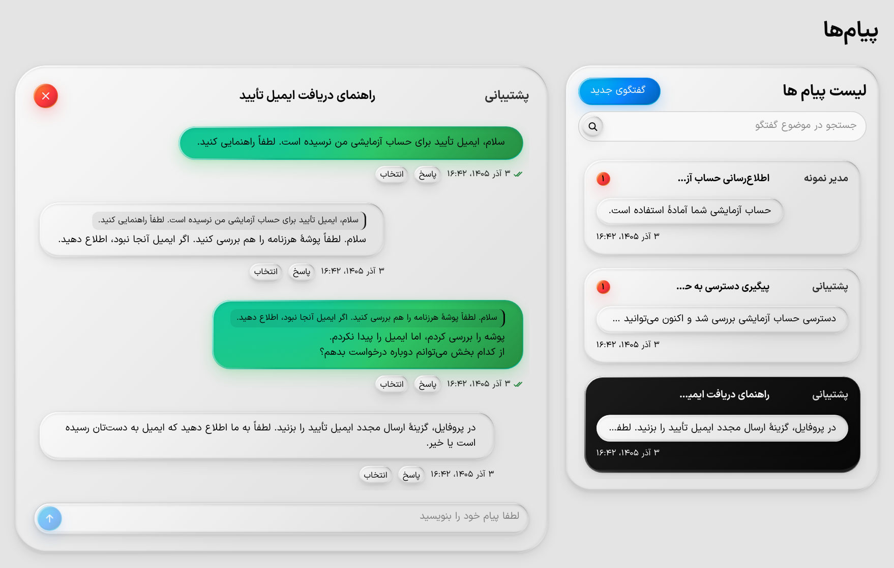
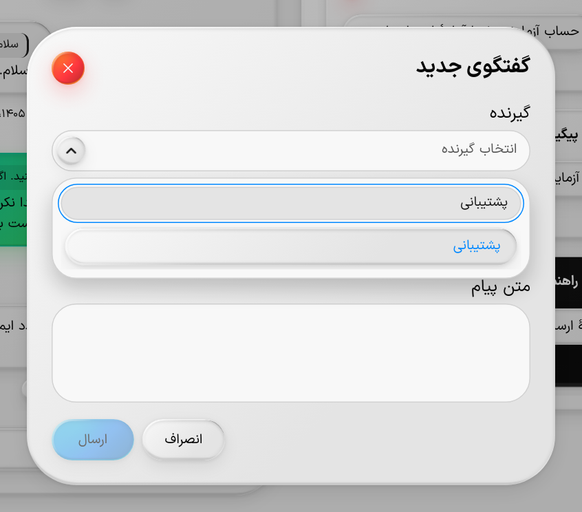
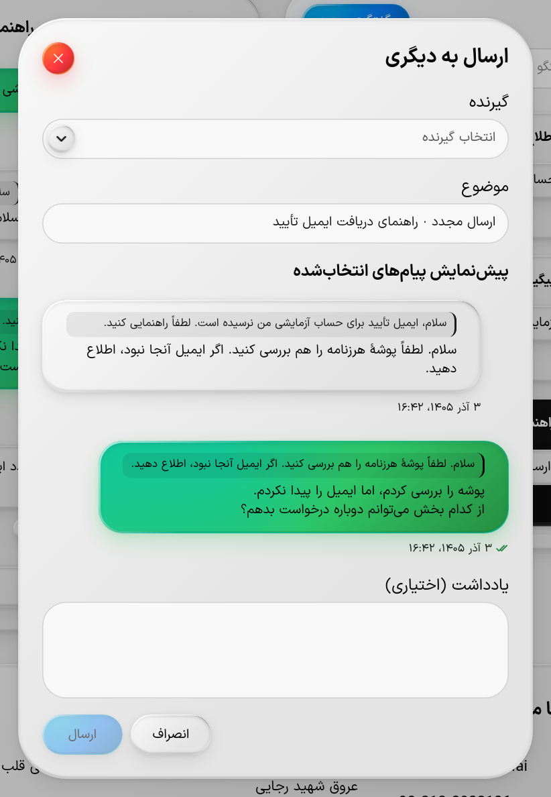
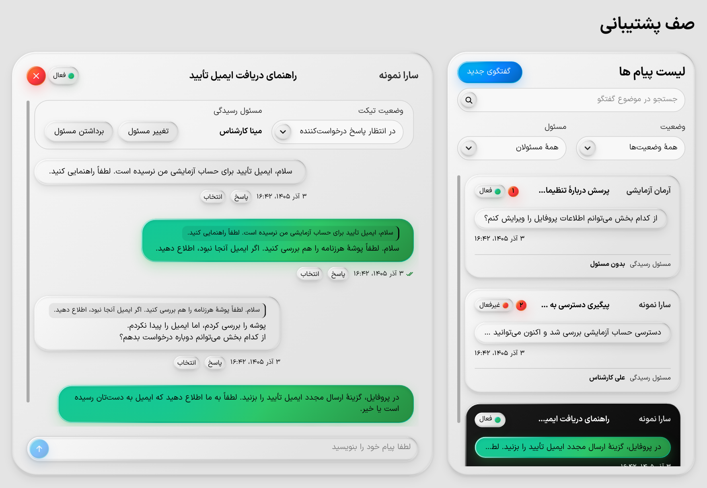
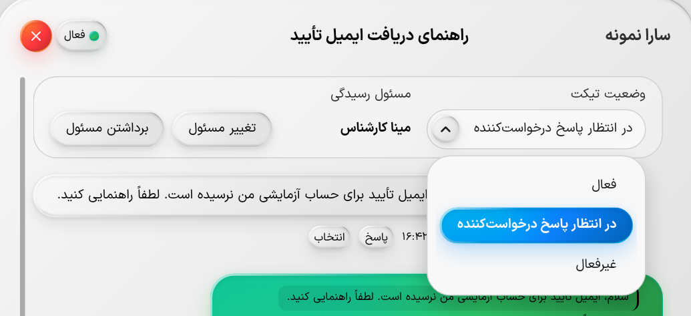
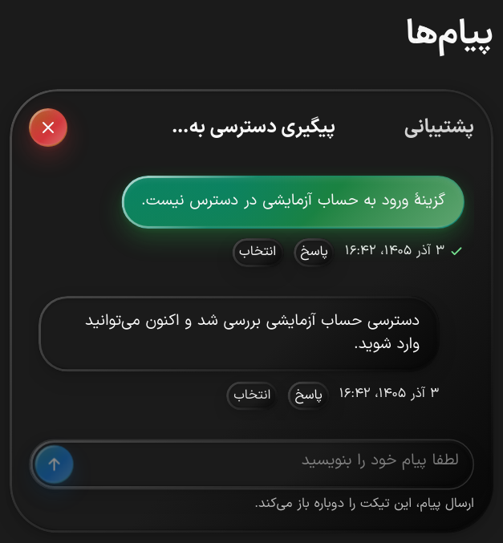

<div lang="fa" dir="rtl">

# راهنمای پیام‌رسانی و تیکت‌های پشتیبانی NCIBB

[English guide](messaging-ticketing.en.md)

## ۱. راهنمای استفاده از پیام‌ها و تیکت‌ها

در NCIBB پیام‌ها و درخواست‌های پشتیبانی در یک محیط گفتگو نمایش داده می‌شوند. هر گفتگویی که به مقصد مشترک **پشتیبانی** ارسال شود، یک تیکت است. پیام‌های مستقیم مجاز، گفتگوهای استاد و دانشجو و پیام‌های صف مدیریت به‌صورت گفتگوی عادی ثبت می‌شوند.

برای مشاهدهٔ گفتگوها از مسیر **پروفایل ← پیام‌ها** وارد شوید. کارشناسان دارای دسترسی پشتیبانی، نمای **صف پشتیبانی** را هم برای رسیدگی به همان تیکت‌ها در اختیار دارند. تصاویر این راهنما از رابط فارسی برنامه با حساب‌ها و پیام‌های آزمایشی تهیه شده‌اند.

### خواندن و پاسخ دادن

- **لیست پیام ها** موضوع، طرف گفتگو، آخرین پیام و زمان آن را نشان می‌دهد. نشان قرمز تعداد پیام‌های خوانده‌نشده را مشخص می‌کند. برای پیدا کردن گفتگو از کادر جستجوی موضوع استفاده کنید.
- با انتخاب گفتگو، تاریخچهٔ آن باز می‌شود. پیام‌های ارسالی شما در حباب سبز سمت راست و پیام‌های دریافتی در حباب خنثی سمت چپ قرار می‌گیرند. در صفحه‌های باریک، دکمهٔ بستن شما را به فهرست گفتگوها برمی‌گرداند.
- برای پاسخ عادی، متن را در کادر پیام وارد کنید. برای نقل‌قول از یک پیام، زیر آن **پاسخ** را بزنید. دکمهٔ بستن کنار پیش‌نمایش، نقل‌قول را حذف می‌کند. وقتی متن از فضای کادر بیشتر شود، دکمهٔ گسترش ظاهر می‌شود.
- ساعت یعنی پیام در حال ارسال است، یک تیک سبز یعنی سرور پیام را پذیرفته و دو تیک یعنی دست‌کم یک خوانندهٔ مجاز دیگر گفتگو را باز کرده است. نشان قرمز خطا، ارسال ناموفق را مشخص می‌کند و پیش‌نویس برای تلاش دوباره در دسترس می‌ماند.
- در زبانهٔ قابل مشاهده، فهرست و تازه‌ترین پیام‌ها تقریباً هر چهار ثانیه به‌روز می‌شوند. بازگشت به زبانه یا وصل شدن دوبارهٔ اینترنت نیز باعث به‌روزرسانی می‌شود.



*تصویر ۱. صندوق پیام‌های درخواست‌کننده و یک گفتگوی پشتیبانی باز.*

### ایجاد گفتگو یا ثبت تیکت

1. **گفتگوی جدید** را بزنید. در صندوق خالی این دکمه کنار عنوان صفحه و در صندوق دارای سابقه در سربرگ فهرست قرار دارد.
2. منوی **گیرنده** را باز کنید و داخل همان منو جستجو کنید. مقصدهای موجود بر اساس حساب و نقش شما تعیین می‌شوند.
3. برای ثبت تیکت، **پشتیبانی** را انتخاب کنید. برای گفتگوی عادی، یکی از مقصدهای مجاز دیگر را انتخاب کنید.
4. موضوع و متن پیام را وارد کنید و **ارسال** را بزنید. گفتگوی جدید در صندوق پیام‌ها باز می‌شود.



*تصویر ۲. جستجوی مقصد مشترک پشتیبانی.*

### ارسال پیام‌های انتخاب‌شده به دیگری

1. زیر هر پیام موردنظر **انتخاب** را بزنید. می‌توانید حداکثر ده پیام را از صفحه‌های مختلف همان گفتگو انتخاب کنید. برای برداشتن انتخاب، دوباره همان دکمه را بزنید.
2. در سربرگ گفتگو **ارسال به دیگری** را انتخاب کنید. پنجره، پیام‌ها را به ترتیب زمانی، با رنگ حباب اصلی و متن کامل نشان می‌دهد.
3. گیرندهٔ مجاز را انتخاب و موضوع را بررسی کنید. در صورت نیاز یادداشت بگذارید و **ارسال** را بزنید تا گفتگوی جدید با نسخه‌ای از متن پیام‌های انتخاب‌شده ساخته شود.

گفتگوی مبدأ و تاریخچهٔ آن در دسترس می‌مانند. نقل‌قول‌ها در پیش‌نمایش، زمینهٔ پیام اصلی را نشان می‌دهند. نسخه‌های ارسالی حاوی متن پیام‌های انتخاب‌شده‌اند.



*تصویر ۳. بررسی پیام‌های انتخاب‌شده پیش از ارسال.*

### رسیدگی در صف پشتیبانی

کارشناسان می‌توانند **صف پشتیبانی** را بر اساس موضوع، وضعیت و مسئول رسیدگی فیلتر کنند. پس از باز کردن تیکت، با **به عهده می‌گیرم** آن را به خود اختصاص دهید، برای کارشناس مجاز دیگری تعیین مسئول کنید، مسئول را بردارید یا **وضعیت تیکت** را تغییر دهید. مسئول رسیدگی مشخص می‌کند چه کسی پیگیر تیکت است. تیم پشتیبانی به صف مشترک دسترسی دارد.

نشان شیشه‌ای وضعیت برای کارشناسان پشتیبانی نمایش داده می‌شود. درخواست‌کننده گفتگو را در صندوق پیام‌های خود دنبال می‌کند و می‌تواند با پاسخ دادن به یک تیکت حل‌شده، آن را دوباره باز کند.



*تصویر ۴. صف پشتیبانی، مسئول رسیدگی و کنترل‌های کارشناس.*

| وضعیت گردش کار | نشان کارشناس | رفتار |
| --- | --- | --- |
| باز (`open`) | سبز، فعال | تیکت تازه با این وضعیت و بدون مسئول ساخته می‌شود. کارشناس می‌تواند رسیدگی را به عهده بگیرد و پاسخ دهد. |
| در انتظار پاسخ درخواست‌کننده (`waiting`) | سبز، فعال | کارشناس هنگام انتظار برای اطلاعات بیشتر این وضعیت را انتخاب می‌کند. پاسخ موفق بعدیِ درخواست‌کننده، تیکت را به حالت باز برمی‌گرداند. |
| حل‌شده (`resolved`) | قرمز، غیرفعال | کارشناس پس از حل درخواست این وضعیت را انتخاب می‌کند. تاریخچه و امکان پاسخ در دسترس می‌مانند. پاسخ درخواست‌کننده همان تیکت را دوباره باز می‌کند. |

کارشناس می‌تواند وضعیت را از منو تغییر دهد. پاسخ کارشناس در نقش پشتیبان، وضعیت انتخاب‌شده را حفظ می‌کند. وضعیت، مسئول رسیدگی و تعداد پیام‌های خوانده‌نشده مستقل از یکدیگر تغییر می‌کنند.



*تصویر ۵. انتخاب وضعیت در بخش کنترل‌های پشتیبانی.*



*تصویر ۶. تیکت حل‌شده در نمای باریک و تیرهٔ درخواست‌کننده. متن زیر کادر پیام توضیح می‌دهد که پاسخ، تیکت را دوباره باز می‌کند.*

## ۲. راهنمای فنی برای توسعه‌دهندگان

### پشتهٔ فنی و نقاط ورود

| لایه | کتابخانه‌ها و مسئولیت‌ها |
| --- | --- |
| فرانت‌اند | رابط و وضعیت آن با React 18 و TypeScript پیاده شده است. React Router زبانه‌های پروفایل را مدیریت می‌کند و Vite برای توسعه و ساخت خروجی استفاده می‌شود. HeroUI رفتار دکمه‌ها و پنجره‌ها را فراهم می‌کند. ظاهر شیشه‌ای NCIBB با CSS و حرکت رابط با Framer Motion پیاده شده است. نسخه‌ها در [package.json](../frontend/package.json) تعریف شده‌اند. |
| کلاینت HTTP | Axios در [api.ts](../frontend/src/dataset_services/api.ts) توکن دسترسی JWT را به درخواست اضافه می‌کند و تمدید آن را مدیریت می‌کند. فراخوانی‌های نوع‌دار در [accountApi.ts](../frontend/src/dataset_services/accountApi.ts) قرار دارند. کلاینت از نشانی نسبی `/api` استفاده می‌کند. پروکسی توسعه در [vite.config.ts](../frontend/vite.config.ts) تعریف شده است. |
| بک‌اند | Django 5.2، Django REST Framework 3.16 و Simple JWT 5.5 مسیردهی، اعتبارسنجی و احراز هویت را بر عهده دارند. PostgreSQL در محیط عملیاتی و SQLite به‌عنوان پیش‌فرض توسعهٔ محلی استفاده می‌شود. [requirements.txt](../backend/requirements.txt) · [settings.py](../backend/ncibb/settings.py) |

نقاط ورود رابط `/profile?tab=messages` و `/profile?tab=support` هستند. زبانهٔ پشتیبانی با قابلیت `messaging.support_queue` نمایش داده می‌شود. مسیریابی بک‌اند از پیشوند `/api/messaging/` استفاده می‌کند. [ProfileManager.tsx](../frontend/src/components/profile/ProfileManager.tsx) · [navItems.ts](../frontend/src/components/profile/sidebar/navItems.ts) · [مسیرهای پروژهٔ Django](../backend/ncibb/urls.py)

### نقشهٔ کد

| محل تغییر | فایل‌های اصلی |
| --- | --- |
| صندوق پیام‌ها، فیلترها، انتخاب گفتگو و باز کردن گفتگوی تازه | [MessagesTab.tsx](../frontend/src/components/profile/messages/MessagesTab.tsx) · [ConversationList.tsx](../frontend/src/components/profile/messages/ConversationList.tsx) |
| تاریخچه، پاسخ، رسید خواندن و انتخاب برای ارسال مجدد | [ConversationDetail.tsx](../frontend/src/components/profile/messages/ConversationDetail.tsx) · [MessageHistory.tsx](../frontend/src/components/profile/messages/MessageHistory.tsx) · [useConversationDrafts.ts](../frontend/src/components/profile/messages/useConversationDrafts.ts) |
| اندازهٔ کادر پیام، جستجوی گیرنده و پنجره‌ها | [ReplyComposer.tsx](../frontend/src/components/profile/messages/ReplyComposer.tsx) · [useReplyInputSize.ts](../frontend/src/components/profile/messages/useReplyInputSize.ts) · [ComposeDialog.tsx](../frontend/src/components/profile/messages/ComposeDialog.tsx) · [useMessagingSearch.ts](../frontend/src/components/profile/messages/useMessagingSearch.ts) · [ProfileModal.tsx](../frontend/src/components/profile/shared/ProfileModal.tsx) |
| تعیین مسئول و نمایش وضعیت ویژهٔ کارشناس | [TicketControls.tsx](../frontend/src/components/profile/messages/TicketControls.tsx) · [TicketBadge.tsx](../frontend/src/components/profile/messages/TicketBadge.tsx) · [ticketStatus.ts](../frontend/src/components/profile/messages/ticketStatus.ts) |
| به‌روزرسانی پس‌زمینه و موقعیت پیمایش | [useMessagingRefresh.ts](../frontend/src/components/profile/messages/useMessagingRefresh.ts) · [useAccountQuery.ts](../frontend/src/components/profile/shared/useAccountQuery.ts) · [useConversationTimeline.ts](../frontend/src/components/profile/messages/useConversationTimeline.ts) |
| چیدمان، رنگ‌ها و ورودی‌های مشترک | [messages.css](../frontend/src/components/profile/messages/messages.css) · [theme.css](../frontend/src/styles/theme.css) · [glass.css](../frontend/src/styles/glass.css) · [DropdownInput.tsx](../frontend/src/components/ui/inputs/DropdownInput.tsx) |
| قرارداد HTTP و نوع‌های TypeScript | [مسیرهای پیام‌رسانی](../backend/messaging/urls.py) · [views.py](../backend/messaging/views.py) · [serializers.py](../backend/messaging/serializers.py) · [accountApi.ts](../frontend/src/dataset_services/accountApi.ts) · [account.ts](../frontend/src/types/account.ts) |
| سیاست مقصد، ذخیره‌سازی و تغییر وضعیت تیکت | [routing.py](../backend/messaging/routing.py) · [recipient_search.py](../backend/messaging/recipient_search.py) · [tickets.py](../backend/messaging/tickets.py) · [models.py](../backend/messaging/models.py) · [access.py](../backend/apps/user_management/access.py) |

### مسیردهی و تعیین مسئول

- مسیر `support_queue` برای فرستنده و تیم پشتیبانی تیکت می‌سازد. `admin_queue` برای پیام پشتیبانی به مدیریت است. مسیرهای `admin_direct` و `support_direct` از مجوزهای مدیر و پشتیبان استفاده می‌کنند. مسیر `mentor` به ارتباط فعال استاد و دانشجو در گروه مربوط نیاز دارد.
- گزینه‌های گیرنده در `available_destinations()` آماده می‌شوند. هنگام ارسال، `validate_destination()` نقش و عضویت گروه را دوباره بررسی می‌کند. محدودهٔ دسترسی خواندن را `readable_threads()` مشخص می‌کند. شناسهٔ گفتگو به‌تنهایی مجوز دسترسی ایجاد نمی‌کند.
- درخواست‌کننده و تیم پشتیبانی می‌توانند تیکت پشتیبانی را بخوانند. قابلیت `messaging.support_queue` مجوز رسیدگی و صلاحیت تعیین مسئول را مشخص می‌کند. فیلد `ticket.assignee` در پاسخ کارشناس مجاز وجود دارد. مقدار `null` یعنی تیکت بدون مسئول است. رابط از وجود این فیلد برای نمایش نشان وضعیت و کنترل‌های پشتیبانی استفاده می‌کند.
- مسئول معتبر باید حساب فعال و قابلیت پشتیبانی داشته باشد. اگر مسئول صلاحیت خود را از دست بدهد، صف آن تیکت را بدون مسئول در نظر می‌گیرد. هنگام تعیین مسئول، سرور مسئول مورد انتظار را با مسئول معتبر فعلی داخل تراکنش مقایسه می‌کند.
- بازبینی مدیریتی یک نمای جداگانه و فقط‌خواندنی است که به حساب انتخاب‌شده محدود می‌شود. مشاهدهٔ تاریخچه در این نما رویداد `conversation_reviewed` را ثبت می‌کند. تغییر وضعیت یا مسئول تیکت با `support_ticket_updated` ثبت می‌شود. [مسیردهی](../backend/messaging/routing.py) · [سرویس تیکت](../backend/messaging/tickets.py) · [بازبینی مدیریتی](../backend/apps/user_management/accounts.py)

### مدل داده و به‌روزرسانی

| مدل | مسئولیت |
| --- | --- |
| `MessageThread` | مسیر، موضوع، درخواست‌کننده، گیرنده یا گروه اختیاری، زمان‌ها و فیلدهای تیکت را نگه می‌دارد. وضعیت و مسئول فقط برای مسیر `support_queue` تعریف می‌شوند. شناسهٔ گفتگو، شناسهٔ تیکت هم هست. |
| `ThreadMessage` | فرستنده، متن، زمان ثبت، علامت ارسال مجدد و ارجاع اختیاری `reply_to` را نگه می‌دارد. سرویس پاسخ فقط ارجاع در همان گفتگو را می‌پذیرد. با حذف پیام اصلی، ارجاع پاک می‌شود. |
| `ThreadReadReceipt` | برای هر کاربر و پیام یک رسید خواندن نگه می‌دارد. شمارندهٔ پیام خوانده‌نشدهٔ هر کاربر و تیک خواندن پیام‌های ارسالی بر اساس این رسیدها محاسبه می‌شوند. |

ایجاد گفتگو و پیام‌های اولیه در یک تراکنش انجام می‌شود. عملیات پاسخ، گفتگو را قفل می‌کند، مجوز و ارجاع نقل‌قول را می‌سنجد، پیام را ذخیره می‌کند و زمان آخرین فعالیت را به‌روز می‌کند. اگر فرستنده همان درخواست‌کنندهٔ اولیه باشد، تیکت منتظر پاسخ یا حل‌شده در همان تراکنش باز می‌شود. فهرست بر اساس آخرین فعالیت مرتب می‌شود و پیش‌نمایش کوتاه را از آخرین پیام می‌گیرد. [مدل‌ها](../backend/messaging/models.py) · [مسیردهی و ذخیره‌سازی](../backend/messaging/routing.py) · [تغییر وضعیت تیکت](../backend/messaging/tickets.py)

رابط در زبانهٔ قابل مشاهده و متصل به اینترنت هر چهار ثانیه داده را درخواست می‌کند. اطلاعات گفتگوی فعال و صفحهٔ آخرین پیام‌ها در پس‌زمینه به‌روز می‌شوند و صفحه‌های قدیمی‌تر برای مرور در دسترس می‌مانند. در صفحهٔ آخرین پیام‌ها، رابط پیام‌های دریافتی را تا شناسهٔ آخرین پیام به‌عنوان خوانده‌شده ثبت می‌کند. وقتی کادر پیام گسترش یافته باشد، ثبت رسید تا نمایش دوبارهٔ تاریخچه به تأخیر می‌افتد. پیش‌نویس هر گفتگو تا زمانی که نمای پیام‌ها باز است در حافظهٔ فرانت‌اند نگه داشته می‌شود. [هوک به‌روزرسانی](../frontend/src/components/profile/messages/useMessagingRefresh.ts) · [جزئیات گفتگو](../frontend/src/components/profile/messages/ConversationDetail.tsx) · [وضعیت پیش‌نویس](../frontend/src/components/profile/messages/useConversationDrafts.ts)

### مرجع API

همهٔ مسیرهای جدول با توکن JWT احراز هویت می‌شوند و پیشوند `/api/messaging/` دارند. فهرست گفتگوها و تاریخچهٔ پیام‌ها با ۲۰ رکورد در هر صفحه از صفحه‌بندی DRF استفاده می‌کنند. پاسخ گفتگو برای پیش‌نمایش شامل `preview`، `preview_sender` و `preview_created_at` است.

| روش و مسیر نسبی | ورودی و نتیجه |
| --- | --- |
| `GET destinations/` | ورودی اختیاری `search`. مقصدهای مجاز درخواست‌کننده را با `kind`، `label` و در صورت نیاز شناسهٔ `recipient` یا `group` برمی‌گرداند. |
| `GET threads/` | از `page`، `route` و جستجوی موضوع با `search` پشتیبانی می‌کند. کارشناس می‌تواند از `ticket_status=open\|waiting\|resolved` و `ticket_owner=mine\|unassigned` نیز استفاده کند. فیلترهای تیکت نتیجه را به صف پشتیبانی محدود می‌کنند. |
| `POST threads/` | گفتگو را با `kind`، `subject`، `content` و در صورت نیاز `recipient` یا `group` می‌سازد. پاسخ ۲۰۱ حاوی گفتگوی تازه است. |
| `GET threads/{id}/` | خلاصهٔ گفتگو، مجوز پاسخ، پیش‌نمایش و در صورت وجود اطلاعات تیکت را برمی‌گرداند. |
| `GET threads/{id}/messages/` | تاریخچه را از جدیدترین پیام به قدیمی‌ترین برمی‌گرداند. فیلدهای `reply_to` و `read_by_other` می‌توانند `null` باشند. صفحه با `page` مشخص می‌شود. |
| `POST threads/{id}/messages/` | متن `content` و شناسهٔ اختیاری `reply_to_id` را می‌گیرد. پاسخ ۲۰۱ حاوی پیام جدید است. |
| `POST threads/{id}/read/` | `through` یک شناسهٔ پیام در همان گفتگو است. برای پیام‌های دریافتی با شناسهٔ کمتر یا مساوی آن رسید ثبت می‌شود و پاسخ ۲۰۴ است. |
| `POST threads/{id}/forward/` | فیلدهای ایجاد گفتگو و یک تا ده شناسهٔ `message_ids` از گفتگوی مبدأ را می‌گیرد. `content` یادداشت اختیاری است. پاسخ ۲۰۱ حاوی گفتگوی تازه است. |
| `GET ticket-assignees/` | ویژهٔ پشتیبانی است. با `search` اختیاری، حداکثر ۲۵ کارشناس واجد شرایط را با `{id, name}` برمی‌گرداند. |
| `PATCH threads/{id}/ticket/` | ویژهٔ پشتیبانی است. `status` یا فیلدهای تعیین مسئول یا هر دو را می‌گیرد. برای تغییر مسئول، `assignee_id` و `expected_assignee_id` باید با هم ارسال شوند و هر کدام شناسهٔ مثبت یا `null` هستند. پاسخ، گفتگوی به‌روزشده است. |
| `GET stats/` | شمارنده‌های پیام و اعلان کاربر فعلی را برمی‌گرداند. داشبورد پروفایل از `unread_count` استفاده می‌کند. |

فیلد `reply_to` شامل `id`، `sender_name` و خلاصهٔ متن با فاصله‌های یکدست و حداکثر ۱۸۰ نویسه است. برای پیام ارسالیِ خود کاربر، `read_by_other` تا پیش از ثبت رسید توسط خوانندهٔ مجاز دیگری `false` و پس از آن `true` است. مقدار آن برای پیام دریافتی و در بازبینی مدیریتی `null` است. هویت خوانندگان در دادهٔ داخلی باقی می‌ماند.

موضوع حداکثر ۲۰۰ نویسه و متن پیام حداکثر ۶٬۰۰۰ نویسه دارد. ورودی یا نقل‌قول نامعتبر می‌تواند با ۴۰۰ پاسخ داده شود. گفتگوی ناموجود یا غیرقابل‌دسترسی ۴۰۴ و نوشتن بدون مجوز ۴۰۳ برمی‌گرداند. تعیین هم‌زمان مسئول می‌تواند پاسخ ۴۰۹ داشته باشد. محدودیت مشترک عملیات نوشتن پیام‌رسانی، ۱۲۰ درخواست در ساعت برای هر کاربر است و در صورت عبور از آن پاسخ ۴۲۹ برمی‌گردد. [مسیرها](../backend/messaging/urls.py) · [اعتبارسنجی](../backend/messaging/serializers.py) · [نماهای API](../backend/messaging/views.py)

### تغییر و بررسی قابلیت

1. ابتدا قانون بک‌اند یا قرارداد داده را در ماژول مربوط تغییر دهید. سریالایزر، `accountApi` و نوع‌های TypeScript را هماهنگ نگه دارید. برای تغییرات دسترسی، نقش‌های مجاز و غیرمجاز را در آزمون پوشش دهید.
2. در تغییرات رابط از کنترل‌های شیشه‌ای مشترک و پنجرهٔ پروفایل استفاده کنید. صندوق درخواست‌کننده، صف پشتیبانی و چیدمان باریک راست‌به‌چپ را بررسی کنید. در تغییر تاریخچه، دریافت پیام جدید، حفظ پیش‌نویس، پاسخ نقل‌قولی و انتخاب در چند صفحه را آزمایش کنید.
3. بررسی‌های زیر را اجرا کنید. آزمون رقابت دو کارشناس برای به‌عهده گرفتن یک تیکت روی PostgreSQL اجرا می‌شود. با پایگاه آزمایشی SQLite این آزمون اجرا نمی‌شود.
4. اگر انتشار از مهاجرت تیکت‌ها عبور می‌کند، پیش از اجرای آن پردازش‌های قدیمی بک‌اند را که می‌توانند گفتگو بسازند متوقف کنید. مهاجرت `0005` ابتدا گفتگوهای پیشین پشتیبانی را با وضعیت باز تکمیل می‌کند و سپس قید فیلدهای تیکت را اعمال می‌کند. بک‌اند جدید را قبل از انتشار فرانت‌اند راه‌اندازی کنید. [مهاجرت 0005](../backend/messaging/migrations/0005_tickets_and_quoted_replies.py)

دستورها را در نسخهٔ محلی مخزن و پس از نصب وابستگی‌های پروژه اجرا کنید.

<div dir="ltr">

```bash
cd backend
NCIBB_ENV=development DB_HOST= CACHE_URL= SQLITE_PATH=:memory: .venv/bin/python manage.py check
NCIBB_ENV=development DB_HOST= CACHE_URL= SQLITE_PATH=:memory: .venv/bin/python manage.py makemigrations messaging --check --dry-run
NCIBB_ENV=development DB_HOST= CACHE_URL= SQLITE_PATH=:memory: .venv/bin/python manage.py test messaging apps.user_management --noinput

cd ../frontend
npm run build
```

</div>

نسخهٔ Node را بر اساس [.nvmrc](../.nvmrc) انتخاب کنید. آزمون‌های مربوط به مسیردهی، نقل‌قول، رسید خواندن، تغییر وضعیت تیکت، مهاجرت و تعیین مسئول در [آزمون‌های پیام‌رسانی](../backend/messaging/tests.py) و [آزمون‌های حساب کاربری](../backend/apps/user_management/tests.py) قرار دارند.

</div>
