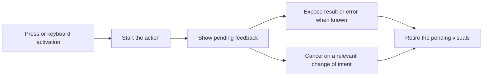

# NCIBB motion principles and implementation guide

Motion should make it clear that an action was received, show where an element came from, and communicate the outcome. The interface should remain usable while transitions run. This guide is for designers specifying motion, developers implementing it, and reviewers reproducing it. The Data Finder at `/portal` is the worked example. The timing tables identify the values in the current implementation and give starting ranges for other features.

- [Principles](#1-principles)
- [Choreography and interruption](#2-choreography-and-interruption)
- [Timing, easing, and effects](#3-timing-easing-and-effects)
- [Shared NCIBB patterns](#4-shared-ncibb-patterns)
- [Recreate the Data Finder](#5-recreate-the-data-finder)
- [Gestures and direct manipulation](#6-gestures-and-direct-manipulation)
- [Accessibility, themes, and rendering](#7-accessibility-themes-and-rendering)
- [Handoff and verification](#8-handoff-and-verification)

## 1. Principles

1. **Acknowledge input immediately.** A press can compress the button or change its tint as soon as contact is recognized. Activation starts the action. A pending indicator reflects actual work, and a success or error cue follows the outcome. A user who abandons a press should see it release without committing the action. [Apple Designing Fluid Interfaces](https://developer.apple.com/videos/play/wwdc2018/803/) · [Apple HIG Feedback](https://developer.apple.com/design/human-interface-guidelines/feedback)
2. **Preserve the identity of elements that persist.** Keep a button, text field, selected item, or panel mounted across its states. Swap only the parts that change. Move one selection indicator between tabs. Measure a pill’s next size and resize it in place. Keep the caret, active focus, and pressed or selected state attached to the same element.
3. **Give spatial motion a visible origin and destination.** A popover grows from its trigger. A sheet belongs to its presenting edge. A shared element travels to the corresponding item in the destination. Use the actual endpoint after layout, collision handling, and reading direction are applied. Keep nearby landmarks still when they help people follow the transition. [Apple HIG Motion](https://developer.apple.com/design/human-interface-guidelines/motion) · [Apple Enhance Your UI Animations and Transitions](https://developer.apple.com/videos/play/wwdc2024/10145/)
4. **Let the latest interaction take effect.** People can close a menu halfway through opening, change a selection while its indicator is moving, or leave a pending search. Retarget from the current visual position. When meaningful motion already exists, preserve its velocity if the animation primitive supports it. Prevent duplicate requests at the request owner. [Apple Animate with Springs](https://developer.apple.com/videos/play/wwdc2023/10158/)
5. **Give the strongest cue to what matters.** A shell can establish place, its foreground can carry meaning, and neighboring layout can make room. Use a highlight or brief blur where it clarifies a change. Use less travel on larger surfaces and shorten effects on interactions that people repeat. [Emil Kowalski’s Practical Animation Tips](https://emilkowal.ski/ui/7-practical-animation-tips)
6. **Keep the experience legible without spatial motion.** A state change still needs readable text, an accessible name or state, and a usable focus target when reduced motion is enabled. Touch, mouse, trackpad, and keyboard can use different visual emphasis while supporting the same action. [Apple HIG Accessibility](https://developer.apple.com/design/human-interface-guidelines/accessibility) · [WCAG Animation from Interactions](https://www.w3.org/WAI/WCAG22/Understanding/animation-from-interactions.html)

## 2. Choreography and interruption

### Define interaction state before animation

Sketch the settled states first. Name who owns each transition and what event causes it. For example, the search request owns `idle`, `pending`, `ready`, and `error`. A result can become available while the pending pill is still leaving. Closing a panel changes its open state and interaction immediately, even if its material takes another fraction of a second to disappear.



Keep the open flag, selected value, request, focus, and accessibility state independent of animation completion. Use the visual lifecycle to clean up an exiting layer. For asynchronous work, cancel or ignore stale responses when the query, feature, or request owner changes. Clear obsolete animation callbacks when a visual target is replaced.

### Design the tracks together

| Track | What it controls | Typical relationship |
| --- | --- | --- |
| Input feedback | Press, focus, selection, or busy cue | Begins with the input or semantic change |
| Container | Surface position, size, shape, and opacity | Establishes where the content belongs and may lead a deliberate reveal |
| Items | Labels, icons, rows, and status text | Reveals with a local fade, scale, blur, or highlight. Related controls can appear together |
| Layout | Real space allocated to siblings | Can grow with the surface and start shrinking during foreground exit |
| Material | Tint, highlight, or a temporary join between surfaces | Supports the spatial change and resolves to the regular resting surface |

For each track, specify the start trigger, start and end values, duration or spring, and dependency on other tracks. Distinguish a surface reaching its visual target from a spring becoming mathematically still. A small overlap keeps the sequence connected. For an ordinary menu, the controls should be readable early while the surface is still settling. For the Smart search pill, the shell leads most of the way and the status text joins during its final travel.

### Author opening and dismissal separately

- **Opening.** Start the acknowledgment immediately, make the anchor visible, and reveal the usable content as the interaction calls for it. Group items by their meaning. Stagger individual items only when the order helps explain the change.
- **Dismissal.** Change the open state immediately. Release focus and hit testing according to the component’s semantics. Let the foreground clear early, then let the shell retreat briefly toward its source or fade where it rests. A temporary connection that explains emergence can disappear for the rest of the interaction.
- **Reopening.** Keep the surface identity and retarget from its current opacity, scale, and position. Restore its interactivity immediately. Apply an entrance delay only to content that still needs the reveal. Give departures that interrupt opening a target at or closer to the origin than the current presentation.
- **Updating.** Hold the stable controls and animate the new label, icon, or subsection. Give a rapid update the latest target. Keep a visible progress message or a valid result tied to the latest request, even when a previous face is still fading.

Use property delays or actual phase boundaries to express overlap. If height or readiness is a prerequisite, use measured geometry or the relevant state event. Keep frame callbacks, presence completion, and delayed cleanup cancelable. [Apple Controlling the Timing and Movements of Your Animations](https://developer.apple.com/documentation/swiftui/controlling-the-timing-and-movements-of-your-animations) · [Motion AnimatePresence](https://motion.dev/docs/react-animate-presence)

## 3. Timing, easing, and effects

### NCIBB values

| Role | Existing value | Where to use it |
| --- | --- | --- |
| General CSS transitions | Fast **120 ms**, normal **200 ms**, slow **300 ms** | Existing `--motion-duration-fast`, `--motion-duration-normal`, and `--motion-duration-slow` tokens |
| Shared glass button press | **70 ms** to scale **0.98**, or **0.96** with a coarse pointer. Press opacity **0.88** | Shared controls. Reduced motion keeps opacity feedback at scale 1 |
| Quick-start settle curve | `cubic-bezier(0.2, 0.8, 0.2, 1)` | `--motion-easing-settle` in CSS and `motionEasing` for the Web Animations API |
| Spatial settle | Spring with stiffness **420**, damping **34**, mass **0.9** | `motionSettle` for compact surfaces that benefit from responsive retargeting |
| Route or view fade | **190 ms**, or **90 ms** with reduced motion | `useNavigationFade` on a persistent view wrapper |
| Standard reduced-motion preset | Opacity entrance **120 ms**, exit **90 ms** | `fadeMotion` or `useMotionVariants` for shared React transitions |
| Measured dialog resize | **240 ms** | `dialogResizeDuration` and `useSurfaceReveal` for data-dependent dialog bodies |
| Compact content swap | **220 ms** in, **130 ms** out | `MotionSwap` for labels, icons, and small states |

[CSS tokens](../frontend/src/styles/theme.css) · [Shared motion styles](../frontend/src/styles/motion.css) · [React motion presets](../frontend/src/components/ui/motion/motionPresets.ts) · [Navigation fade](../frontend/src/components/ui/motion/useNavigationFade.ts)

Start new press feedback around **70–120 ms**, a short alpha change around **80–160 ms**, a compact popover entrance around **140–240 ms**, a popover exit around **90–180 ms**, and measured panel movement around **180–320 ms**. For a deliberately staged reveal, try one to four frames of overlap at 60 Hz and review it without slow motion. Tune by distance, interaction frequency, and legibility. These ranges are starting points. The app’s CSS time values use seconds or milliseconds, Framer Motion durations use seconds, and Web Animations API durations use milliseconds. [Emil Kowalski’s Practical Animation Tips](https://emilkowal.ski/ui/7-practical-animation-tips) · [Motion React Transitions](https://motion.dev/docs/react-transitions)

### Choose how each property moves

| Property or technique | Purpose and treatment |
| --- | --- |
| Opacity | Reveal, clear, or replace items. Use a short transition so foreground becomes readable promptly. A quick fade works for repeated route changes. |
| Translation | Explain origin or direction. For a compact surface, start with a few pixels of travel. Let physical source-to-destination movement justify larger distance. |
| Scale | Suggest press or growth. Start a regular popover near its resting size. Scale a visual layer independently when the hit target or text baseline needs to remain fixed. |
| Real width or height | Allocate space for moving siblings. Measure the natural endpoint at the current viewport, font, and content. Use localized size animation or reserve space if reflow would obscure other controls. |
| Blur and brightness | Soften a short label or icon handoff and add a brief highlight. Start near **1–2 px** of foreground blur for compact controls. Clear the filter at rest and preserve contrast throughout. |
| Spring | Settle spatial values and retarget from the current presentation. Start with a well-damped response. Use deliberate overshoot where release momentum or a rare expressive moment gives it meaning. |
| Temporary material connection | Show that a new surface grows out of a visible source. Limit the effect to the join. Keep real text outside the filter and remove the visible connection before rest. |

A tween is a good match for a bounded fade, timing overlap, or deterministic material change. A physics spring uses mass, stiffness, and damping together. More stiffness pulls toward the target more strongly, more mass increases inertia, and damping dissipates motion. Tune for fast visible progress and a calm arrival. If a library also offers a duration-based spring, choose one parameter system and confirm how it handles interruption and incoming velocity. Use linear timing for constant-rate motion such as the pending ring. [Apple Animate with Springs](https://developer.apple.com/videos/play/wwdc2023/10158/) · [Motion React Transitions](https://motion.dev/docs/react-transitions)

### Choose a web mechanism

- **CSS transitions** suit press, tint, focus, and simple two-state changes. Transition named properties. Use the native control’s press and activation behavior.
- **Framer Motion** suits coordinated tracks, springs, and retained exit visuals. Import from `framer-motion` in NCIBB. Keep `AnimatePresence` at a persistent boundary and key a child by its semantic identity. Key the inner face only when a button needs to stay focused.
- **Web Animations API** suits explicit cleanup and measured retargeting. Read the current displayed value before canceling the previous animation, apply the new resting value, and animate from the displayed value. Guard finished callbacks by animation identity.
- **Shared-layout animation** suits two states of a stable item or a traveling indicator. Scope identities to the component instance and define the fallback for a missing or offscreen endpoint.

[Frontend dependencies](../frontend/package.json) · [Motion Layout Animation](https://motion.dev/docs/react-layout-animations) · [Web Animations specification](https://www.w3.org/TR/web-animations-1/)

## 4. Shared NCIBB patterns

### Buttons, inputs, and feedback

| Interaction | How to reproduce it | Reference implementation |
| --- | --- | --- |
| Standard button | Use the shared glass control. Keep the hit area fixed and use press feedback on the visual control. Check keyboard activation and focus independently of hover. | [GlassButton.tsx](../frontend/src/components/ui/GlassButton.tsx) · [Press and focus styles](../frontend/src/components/ui/GlassButton.css) |
| Stateful action | Keep one button. Swap the icon and label within it. Measure the active face and transition the pill to its new inline size. Crossfade glass tint where it carries state. Use text and an icon for pending, success, and retry. | [StatefulGlassButton.tsx](../frontend/src/components/ui/StatefulGlassButton.tsx) · [ProfileSaveAction.tsx](../frontend/src/components/profile/account/ProfileSaveAction.tsx) |
| Search field and validation | Keep the input and caret stable. Use the shared field shell, focus stroke, and a physical-right search icon. Auto-size a multiline field within a bounded height and scroll the text after the cap. Associate field errors with the input and preserve composition events. | [SearchInput.tsx](../frontend/src/components/ui/inputs/SearchInput.tsx) · [Input styles](../frontend/src/components/ui/inputs.css) |
| Loading | Start the status with actual pending work. Use determinate progress when the backend or task can report it. Otherwise show a readable status with an indeterminate cue. Keep layout steady and preserve useful existing content as the feature permits. | [DatasetSearchForm.tsx](../frontend/src/pages/portal/components/DatasetSearchForm.tsx) |
| Toast | Post the actual outcome through `useToast`. Use the provider’s announcements and compact reveal. Let people finish reading, pause transient success dismissal on hover or focus, and keep failures actionable. | [ToastProvider.tsx](../frontend/src/components/ui/motion/ToastProvider.tsx) · [MotionToast.tsx](../frontend/src/components/ui/motion/MotionToast.tsx) |
| Tooltip | Delay the first hover when it helps avoid accidental activation. Make adjacent transitions within a group quick. Preserve keyboard reachability and use a readable focus-triggered presentation. | [Emil Kowalski’s Practical Animation Tips](https://emilkowal.ski/ui/7-practical-animation-tips) |

For a compact action in an existing form, bind the shared button to the real request state. The form’s submit handler should validate availability and guard against duplicate submits, including the implicit Enter path.

```tsx
import { StatefulGlassButton } from "@/components/ui/StatefulGlassButton"

type SavePhase = "ready" | "pending" | "saved" | "error"

const labels: Record<SavePhase, string> = {
  ready: "ذخیره تغییرات",
  pending: "در حال ذخیره…",
  saved: "ذخیره شد",
  error: "تلاش دوباره",
}

export function SaveAction({ formId, phase }: { formId: string; phase: SavePhase }) {
  const busy = phase === "pending"
  const color = busy ? "pending" : phase === "saved" ? "success" : "primary"

  return (
    <StatefulGlassButton
      type="submit"
      form={formId}
      state={phase}
      label={labels[phase]}
      color={color}
      busy={busy}
      disabled={phase === "saved"}
    />
  )
}
```

### Popovers, dialogs, and measured disclosures

- **Popover or menu.** Use the existing accessible primitive for anchoring, outside dismissal, and keyboard handling. Keep the positioning wrapper steady. Animate an inner surface from the trigger-facing corner. Follow the resolved origin if placement can flip. When a user dismisses the topmost nested popup, let its parent remain open where the interaction calls for it. A settings panel with fields uses dialog semantics. A menu of commands follows the menu keyboard pattern. [Apple HIG Popovers](https://developer.apple.com/design/human-interface-guidelines/popovers) · [WAI Menu Button Pattern](https://www.w3.org/WAI/ARIA/apg/patterns/menu-button/)
- **Dialog or sheet.** Keep focus containment, backdrop, and scroll ownership with the modal primitive. Place initial focus according to the task, and return it to the trigger or a sensible surviving target on close. A sheet’s visual origin is its presenting edge. Keep cancellation and confirmation distinct. [ProfileModal.tsx](../frontend/src/components/profile/shared/ProfileModal.tsx) · [WAI Modal Dialog Pattern](https://www.w3.org/WAI/ARIA/apg/patterns/dialog-modal/) · [Apple HIG Sheets](https://developer.apple.com/design/human-interface-guidelines/sheets)
- **Measured disclosure.** Keep the toggling control in place. Size the changing section to its natural content and clip only where the size transition needs it. Reveal those items during the expansion. On close make the departing controls inert and release their space, keeping adjacent controls stable where possible. An exiting view can paint briefly while interaction and focus already belong elsewhere.
- **Data-dependent Profile dialog.** Know the nearest expected body size before data arrives. `ProfileModal` exposes `animateSize`, `bodyKey`, `contentPending`, and `estimatedBodySize`. Use readable loading content, then measure and settle the real body size over **240 ms**. The dialog’s optical reveal is a distinct **480 ms** treatment after geometry settles. It clears brightness first (0–27%), blur next (27–75%), and finishes the opacity fade (75–100%). The stronger **15 px blur**, **4× brightness**, and **0.6 opacity** belong to this dialog foreground pattern. Compact controls use the milder presets. Under reduced motion, apply size immediately and keep the short fade. [ProfileModalBody.tsx](../frontend/src/components/profile/shared/ProfileModalBody.tsx) · [useSurfaceReveal.ts](../frontend/src/components/ui/motion/useSurfaceReveal.ts) · [Optical styles](../frontend/src/styles/motion.css)

### Navigation and data views

- **Tabs and modes.** Animate a single indicator under stable labels. Derive its width and location from the selected control after layout. Keep the selected item visible in a scrollable rail. Set the route or selected value as soon as the user acts. Apply a short opacity change to the new panel when it helps orient the user. [GlassTabs.tsx](../frontend/src/components/ui/GlassTabs.tsx) · [Glass navigation styles](../frontend/src/styles/glass.css)
- **Lists, tables, and messaging.** Preserve element keys across polling, sorting, and filtering. Keep visible history and scroll position on a background refresh where appropriate. Use motion for the changed, removed, or reordered groups when it helps people track the difference. [Conversation timeline](../frontend/src/components/profile/messages/useConversationTimeline.ts) · [Messaging guide](messaging-ticketing.en.md)
- **Charts and visualization.** Use transitions to connect marks representing the same data and maintain readable axes and stable reference points. Stage a complex change when an intermediate view makes the mapping easier to follow. Keep the chart readable at rest and provide an immediate update under reduced motion. [Heer and Robertson, Animated Transitions in Statistical Data Graphics](https://vis.stanford.edu/papers/animated-transitions.html)
- **Scroll-linked scenes and illustrations.** Attach motion to an observable viewport or interaction state. Use lightweight or static representations when the effect is offscreen or reduced motion is enabled. Keep vital labels and controls available as part of the ordinary interface.

## 5. Recreate the Data Finder

The Data Finder has two top-level modes, **دیتاست** (Datasets) and **دیتابیس** (Database). Within Datasets, **هوشمند** (Smart) and **دستی** (Manual) are search methods. Smart supports sorting by **شباهت** (Similarity) as its default for search results. Manual exposes search subject, variable filters, and its own sort options. The mode indicator belongs to the top-level control. The settings panel and processing pill belong to the Datasets search form. [Portal route](../frontend/src/pages/portal/index.tsx) · [Search options](../frontend/src/pages/portal/datasetSearchOptions.ts)

### Build the resting geometry and behavior

1. Use the shared multiline `SearchInput`, with `dir="auto"` on the textarea and the glass magnifying button physically on the right. Put the settings action physically on the left. Align the buttons to the bottom as the textarea grows and scroll the textarea after its configured height limit. Keep text direction separate from physical icon placement.
2. Use the same search shell box for the progress endpoint. Observe the actual search shell’s height with `ResizeObserver` and align the pill’s horizontal bounds with that shell, excluding the settings button and its gap. Let the processing pill use the shared input radius, fill, and stroke. Wrap it in a layout track whose height includes the gap above it.
3. Open the nonmodal HeroUI settings popover **8 px below** the settings button. The current finder uses `bottom-end` in the RTL layout, aligned to the trigger’s physical left. Keep this below-trigger placement on mobile. Let the positioning wrapper remain fixed during the inner material animation. Use a `top left` transform origin for the surface and controls, and keep the list of settings scrollable within the viewport limit.
4. Keep the method control and the sorting control in place when Manual rows appear between them. Use the standard dropdown for each field. Give Manual rows their own measured-height and foreground tracks. In Smart, show **شباهت** by default and leave the other Smart sort options available.
5. On accepted submit, close any open settings, set pending state, and swap the magnifier to the dot ring inside the same button. Mount the processing pill only for Smart. Start Manual’s filtering once the simple pending acknowledgment has a chance to paint. Announce status through the form’s live region independently of the visual pill. Update each button’s accessible name to match its current role, including the search action while pending and the settings action when it becomes reset.

[Search form](../frontend/src/pages/portal/components/DatasetSearchForm.tsx) · [Portal styles](../frontend/src/pages/portal/styles.css) · [Settings popover](../frontend/src/pages/portal/components/DatasetSearchOptions.tsx) · [Search lifecycle](../frontend/src/pages/portal/hooks/useDatasetSearch.ts)

### Settings panel chronology

Times are relative to the accepted open, close, or method change. Entrance and exit run on the current rendered values when interrupted.

| Event | Container and layout | Foreground and semantics |
| --- | --- | --- |
| Open settings | Grow from `scaleX(0.93)`, `scaleY(0.9)`, and `y = −6 px` to rest with `motionSettle`. Fade the material in over **105 ms**. | Reveal controls as a group after **35 ms** over **115 ms**, from 0 opacity, `scale(0.99)`, 1.5 px blur, and 1.08× brightness. Clear the foreground filter at rest. |
| Close settings | Start a **125 ms** retreat after **20 ms**. Target at most 0.97 horizontal scale, 0.95 vertical scale, and `y = −4 px`, constrained toward the origin from the current position. Fade the material over **80 ms** starting at **35 ms**. | Fade and soften the controls over **75 ms** from dismissal. Return focus when it was inside the panel and make the retained exit inert. Reopening retargets the same panel and restores interaction. |
| Switch to Manual | Expand the Manual section from zero to its natural height over **200 ms**. The shared material follows the changing layout. | Keep method and sort controls mounted. Fade the new rows from 1.5 px blur over **120 ms** after **40 ms**. Initial panel entry while already in Manual uses the grouped panel reveal. |
| Switch to Smart | Begin shrinking the Manual section after **20 ms** and complete the shrink over **145 ms**. | Disable the exiting group’s interaction immediately and clear it over **75 ms**. Keep the selected method available during the change. |
| Reduced motion | Apply Manual size immediately and keep the popover anchored. | Use the shared short fade at the panel boundary. Keep keyboard, dismissal, and control state available. |

[Panel motion](../frontend/src/pages/portal/components/DatasetSearchOptionsPanel.tsx) · [Manual rows](../frontend/src/pages/portal/components/DatasetManualOptions.tsx)

### Smart processing chronology

Use accepted submit as time zero for entry. Use actual completion, failure, or cancellation as time zero for exit while the finder remains mounted. Changing to Database clears the dataset search and replaces the view.

| Track | Entry from pending | Exit from outcome or dismissal |
| --- | --- | --- |
| Search action | Swap the magnifier to the dot ring at the pending state change. Keep the same button, focus target, and dimensions. | Restore the magnifier as pending clears. On success the settings action changes to reset with its own icon swap. On failure show the inline error and make retry available. |
| Layout | Grow from zero to the measured extent in **240 ms**, moving the results as the space opens. | Start reducing the extent at **35 ms** and finish over **150 ms**. |
| Shell | Translate from `y = −16 px` to rest and expand from `scaleX(0.96)` and `scaleY(0.9)` over **240 ms**, anchored at its top center. Fade from 0 over **110 ms**. | At **25 ms**, begin a **140 ms** retreat toward the input, bounded by the current position and scale. The resting exit targets are `y = −5 px`, 0.98 horizontal scale, and 0.96 vertical scale. Fade over **95 ms** starting at **45 ms**. |
| Gooey join | Start connected. Narrow the connector as the pill separates and fade the connector between **75 and 185 ms**. | Fade any remaining connector quickly. A settled pill leaves using the shell retreat. |
| Label and detail | Start at **192 ms** on a fresh entrance, **48 ms** before the shell’s scheduled finish. Fade in over **95 ms**. In parallel scale **0.98 → 1** and clear **2 px** blur and **1.18×** brightness over **140 ms**. Swap subsequent status messages locally. | Start immediately with a **75 ms** fade and slight softening and compression. Results or the error are available from the underlying outcome, independent of this visual tail. |
| Reduced motion | Apply the final layout immediately. Use a short fade, static pending ring, and readable status. | Release layout immediately and retain the outcome feedback. |

For the connector, place a small SVG at the seam between the input and pill. Draw a stationary rounded source and a moving rounded piece in the same themed fill. Apply a Gaussian blur with standard deviation **3.5**, then amplify and offset the alpha channel with `18 × alpha − 15` so the nearby edges briefly join. The finder confines the filter to a **120 × 44** SVG view box and the rendered width to `min(6rem, 35%)`. The moving piece narrows from scale X **1** to **0.58** over **180 ms**. Give each instance a unique SVG filter ID. Draw the crisp input, resting pill, and text on their own layers. Skip the connector with reduced motion or when a suitable filter is unavailable.

Use the request result immediately if it arrives during entrance. The delayed label is allowed to disappear before it becomes visible. Avoid any minimum wait added just to complete the effect. On reset, clear the search and return focus to the textarea. [Processing choreography](../frontend/src/pages/portal/components/DatasetProcessingPill.tsx) · [Bounded SVG join](../frontend/src/pages/portal/components/DatasetGooSurface.tsx) · [Search lifecycle](../frontend/src/pages/portal/hooks/useDatasetSearch.ts)

## 6. Gestures and direct manipulation

These guidelines apply when the interaction actually provides a gesture, such as dragging a panel, reordering, swiping, or panning a visualization.

1. **Start in the current presentation.** On grab, preserve the pointer-to-object offset so interrupting a settle produces no jump. Keep coordinates and velocity in one space. Let the object follow meaningful movement directly while the user is tracking it.
2. **Resolve ownership deliberately.** A press cue can happen immediately. Use the platform’s movement tolerance for gestures that compete with tap or scroll. Capture the pointer once a custom drag takes ownership. Preserve browser scroll, pinch, and system edge gestures where expected. Set the applicable `touch-action` before the gesture starts.
3. **Commit or cancel.** Handle release, pointer cancellation, lost capture, and unmount. A cancelled motion returns from its current presentation and preserves the previous committed state. Support a visible control and a keyboard route for eligible drag-only actions.
4. **Choose a legal rest point.** Prefer platform release projection. For a small custom set of snap positions, `clamp(position + velocity * lookAheadSeconds, min, max)` can estimate a destination. Use consistent units and tune on real gentle and fast releases. Pass velocity in the engine’s expected units. Normalize by signed remaining travel only when the engine requires a relative velocity and that distance is large enough for a stable result.
5. **Bound the effect.** A visual resistance curve can communicate an edge by yielding less for each additional movement. Keep the actual snap positions fixed. Start with a calm settle and use overshoot sparingly. Offer discrete movement or reorder controls where direct manipulation is unavailable.

[Apple Designing Fluid Interfaces](https://developer.apple.com/videos/play/wwdc2018/803/) · [Apple HIG Gestures](https://developer.apple.com/design/human-interface-guidelines/gestures) · [Emil Kowalski’s Apple Design Skill](https://github.com/emilkowalski/skills/blob/main/skills/apple-design/SKILL.md) · [W3C Pointer Events](https://www.w3.org/TR/pointerevents3/) · [WCAG Dragging Movements](https://www.w3.org/WAI/WCAG22/Understanding/dragging-movements.html)

## 7. Accessibility, themes, and rendering

### Input, focus, and announcements

- Keep active controls keyboard-operable during visual entry. Retained exit DOM should release hit testing and focus, including nested dropdowns owned by the exiting panel. Use the library’s focus and dismissal behavior, with `inert` for a retained subtree where appropriate. Restore logical focus before hiding that subtree. Distinguish Escape from outside activation, where the clicked target can receive focus.
- Keep state messages independent of animation. Use an accessible name and state on controls, a polite live region or `role="status"` for progress and ordinary completion, and an appropriate alert or field association for actionable errors. Hide visual duplicates from assistive technology. Make meaning clear with text and state cues alongside color.
- Use `useReducedMotionPreference` or a shared motion preset for React and `prefers-reduced-motion` for CSS. Remove nonessential travel, scaling, looping, blur, or connector effects as appropriate. Apply target geometry directly and retain a readable state or brief fade. Honor preference changes while the app is mounted.
- For an interaction being adapted to a native Apple target, give the system control first ownership of its tactile feedback and transitions. If a custom haptic clarifies an event, align it to a genuine detent or completed action, respect the system setting, and keep text or visual feedback sufficient on its own.

[Reduced-motion hook](../frontend/src/components/ui/motion/useReducedMotionPreference.ts) · [HTML inert subtrees](https://html.spec.whatwg.org/multipage/interaction.html#inert-subtrees) · [WAI Status Messages](https://www.w3.org/WAI/WCAG22/Understanding/status-messages.html) · [Apple HIG Playing Haptics](https://developer.apple.com/design/human-interface-guidelines/playing-haptics)

### RTL, typography, and glass

- Use logical layout properties when a position should follow reading direction. For physical placements required by the design, such as the finder’s right-side magnifier, keep the physical placement explicit and allow the field’s text to choose its own direction.
- Check both Persian and English, mixed-script labels, narrow widths, zoom or larger system text, mobile browser chrome, and the on-screen keyboard. Measure with actual fonts and wrapping. Keep persistent labels aligned while a surrounding surface moves.
- Reuse NCIBB’s glass surfaces, theme colors, radius, and spacing tokens. Test the label, icon, focus stroke, and boundaries while the background behind them moves. Increase separation or use a solid surface if dynamic content reduces legibility. Keep foreground blur separate from backdrop blur.
- Use the host’s contrast and transparency settings where supported. A dimming scrim communicates the relationship to an underlying view. Its opacity timeline is independent of when that view receives input.

[NCIBB glass styles](../frontend/src/styles/glass.css) · [Apple HIG Right to Left](https://developer.apple.com/design/human-interface-guidelines/right-to-left) · [Apple HIG Typography](https://developer.apple.com/design/human-interface-guidelines/typography) · [Apple HIG Materials](https://developer.apple.com/design/human-interface-guidelines/materials)

### Rendering and measurement

- Prefer transforms and opacity for visual-only movement. When siblings need room, animate the smallest wrapper that actually owns their layout. Measure an untransformed endpoint. Observe size changes when viewport, font, wrapping, or data can change the result. Clean up observers and animated inline sizes on unmount.
- Limit a blur, mask, or SVG filter to the layer and area that need it. Check stacking and containing-block effects around portals. Avoid a full-surface filter under moving text or a live canvas when a small foreground transition can express the same change.
- Compare the first visible acknowledgment with the time to settle. Use a browser performance trace to inspect script, layout, paint, and compositing costs. At 60 Hz a frame interval is about **16.7 ms**, and at 120 Hz it is about **8.3 ms**. The app and platform share that time. Profile with real content, the actual background effect, and realistic device constraints. A simulated viewport can validate behavior and geometry. Physical devices are the reference for touch feel and rendering smoothness.

[Chrome Animation Performance Guide](https://web.dev/articles/animations-guide) · [Apple Explore UI Animation Hitches and the Render Loop](https://developer.apple.com/videos/play/tech-talks/10855/)

## 8. Handoff and verification

### Specify a transition so another person can reproduce it

Record these fields in the design or issue. Include settled screenshots or frames and, when timing matters, a short recording at normal speed.

| Field | What to record |
| --- | --- |
| Entry point and purpose | Route, trigger, input method, and what the motion communicates |
| States and ownership | Resting states, activating event, pending and outcome source, and what cancels or overrides the action |
| Geometry | Stable element identity, source and target, coordinate system, alignment or origin, responsive placement, and space allocated to siblings |
| Tracks | Start and end values for shell, foreground, layout, and material, with exact durations or spring parameters and overlap |
| Exit and recovery | Closing trigger, focus destination, input release, paint cleanup, and behavior if another action arrives mid-transition |
| Accessibility | Reduced-motion behavior, keyboard use, announcements, RTL, zoom, themes, and touch targets |
| Acceptance checks | What should be visible immediately, before settle, at rest, during interruption, and after exit |

Implement the resting states first. Add input feedback, then establish spatial continuity, then tune the foreground and exit. Use a component’s real entry point for review. A screenshot can confirm alignment and hierarchy. Use a recording or live interaction for response time, order, and interruption. When giving feedback, identify the observable problem, its effect on the user, and the smallest correction. [Apple HIG Motion](https://developer.apple.com/design/human-interface-guidelines/motion) · [Apple Design Skill review approach](https://github.com/dickwu/apple-design-skill) · [Apple UI Designer](https://aiuxplayground.com/skills/apple-ui-designer)

### Reproduce and verify the Data Finder

Use the existing frontend environment from the [project setup guide](../README.md#development-setup). In a development checkout, run `npm run dev` from `frontend/` and open `/portal`. Use the configured backend or a local fixture for Smart responses. A fixture can send fast results, a delayed status update followed by results, or an error without depending on live search timing.

| Test | Expected observation |
| --- | --- |
| Open settings in narrow Persian RTL and desktop layouts | The panel sits below the settings button and grows from the near corner. Controls become readable as the shell settles. |
| Close immediately after opening and reopen during exit | The panel follows the latest action, with a continuous position and one dialog. Focus and hit testing follow semantic state immediately. |
| Use the keyboard and close with Escape | Trigger and dropdowns can be operated. An open nested dropdown can dismiss first. Closing settings returns focus when focus was inside the panel. |
| Switch Smart → Manual → Smart quickly | Manual rows expand or collapse while the method control stays mounted. The exiting controls stop accepting input. Smart exposes similarity sorting. |
| Submit a multiline Smart query | The search icon starts swapping to the pending ring as soon as the request is pending. The pill aligns with the wrapping input and matches its final height. Space opens smoothly. Its text enters near the end of the shell’s travel. |
| Exercise short, streamed, failed, and cancelled requests | The latest status and outcome are visible without waiting for a decorative effect. Failure shows an inline message and permits retry. A stale response cannot replace the current view. |
| Submit a Manual query and reset either method | Manual uses the pending icon with no processing pill. After completion, reset clears the field and focuses it. |
| Try light and dark themes, English and Persian text, zoom, and keyboard appearance | Content remains readable, reachable, and aligned. Text uses the appropriate direction, with the magnifier on the physical right. |
| Repeat with reduced motion | Essential feedback remains. Panel and pill geometry update immediately where targeted, and the Smart connector and rotating ring are absent. |
| Repeat on physical devices and record if motion hitches | The control reacts promptly with real background work. Inspect presentation delay, layout, and filtered-area rendering on the target device. |

Measure the order and overlap in a recording or performance trace. Prefer assertions about observable behavior over exact frame times in automated tests. State the browser, viewport, input, theme, motion preference, and fixture when sharing verification. Run the production build from `frontend/` with `npm run build` when shipping code. The [rollout guide](../README.md#automatic-frontend-publishing-on-the-ncibb-host) describes NCIBB’s automatic publishing workflow.

### Local Smart search fixture

This optional fixture takes the place of the backend for the local finder walkthrough. Start it in a separate terminal. It supplies an immediate result for `Fast`, an error for `Failure`, and a delayed status followed by an empty result for any other query. The empty result still exercises the successful outcome and reset action. The browser receives the status as it is streamed. [Vite proxy](../frontend/vite.config.ts) · [Smart search stream handler](../frontend/src/dataset_services/datayabService.ts)

```bash
node --input-type=module <<'JS'
import { createServer } from "node:http"
import { setTimeout as pause } from "node:timers/promises"

createServer(async (request, response) => {
  if (request.method !== "POST" || request.url !== "/api/datayab/search/") {
    response.writeHead(200, { "Content-Type": "application/json" })
    response.end("[]")
    return
  }

  const chunks = []
  for await (const chunk of request) chunks.push(chunk)
  const { query } = JSON.parse(Buffer.concat(chunks).toString("utf8"))
  response.writeHead(200, { "Content-Type": "text/event-stream" })
  response.flushHeaders()
  const send = (event) => response.write(`data: ${JSON.stringify(event)}\n\n`)

  if (query !== "Fast") {
    await pause(550)
    if (response.destroyed) return
    send({ type: "status", step: "analyze", in_domain: true, search_query: query })
    await pause(550)
  }

  if (response.destroyed) return
  send(query === "Failure"
    ? { type: "error", detail: "Fixture failure" }
    : { type: "result", results: [], count: 0 })
  response.end()
}).listen(8320, "127.0.0.1")
JS
```

Start Vite from `frontend/` with `NCIBB_API_ORIGIN=http://127.0.0.1:8320 npm run dev` and open `/portal`. For the cancellation case, submit a query other than `Fast` and switch to Database while it is pending. For the multiline case, use Shift+Enter within the query. Stop the fixture when the walkthrough is complete.

### Further reading

- Apple's HIG and WWDC sessions explain responsive, spatially consistent interaction and the relationship between an animation’s visible duration and settling. [Human Interface Guidelines](https://developer.apple.com/design/human-interface-guidelines/) · [Designing Fluid Interfaces](https://developer.apple.com/videos/play/wwdc2018/803/) · [Animate with Springs](https://developer.apple.com/videos/play/wwdc2023/10158/) · [Meet Liquid Glass](https://developer.apple.com/videos/play/wwdc2025/219/)
- Emil Kowalski’s practitioner examples cover press feedback, trigger-based origins, small optical handoffs, and direct manipulation. UI Skills and OpenDesign list the same upstream skill. [Practical Animation Tips](https://emilkowal.ski/ui/7-practical-animation-tips) · [UI Skills](https://www.ui-skills.com/skills/emilkowalski/apple-design) · [OpenDesign](https://open-design.ai/skills/apple-design/)
- The Apple design review skills and iOS motion case study supply workflow examples for evaluating platform conventions, hierarchy, and the order of transitions. [Apple Design Skill](https://github.com/dickwu/apple-design-skill) · [Apple UI Designer](https://aiuxplayground.com/skills/apple-ui-designer) · [iOS 26 Motion Design Guide](https://medium.com/@foks.wang/ios-26-motion-design-guide-key-principles-and-practical-tips-for-transition-animations-74def2edbf7c)
